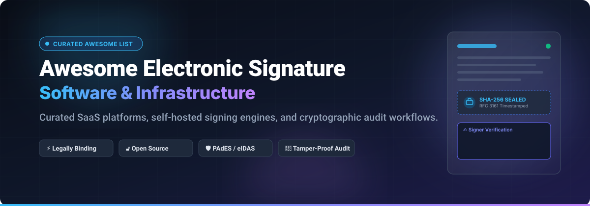

  

# 📑 Awesome Electronic Signature Software & Infrastructure 🚀

  
  
  
  
  
  

---

## 🌟 Top Electronic Signature Software & Digital Agreement Ecosystem ✍️

> **A Curated Directory of SaaS Signing Platforms, Self-Hosted E-Signature Suites & Cryptographic Open-Source Libraries**  
> *Engineered for legally binding e-signatures, compliant audit trails, PAdES/eIDAS standards, and enterprise digital transaction management (DTM).*  
> **Last updated: March 2026** 📅

This repository tracks notable **SaaS platforms** and **open-source projects** for **Electronic Signature Software**. These tools empower businesses, legal engineering teams, and software developers to execute legally binding contracts—covering envelope routing, interactive field placement, multi-factor signer authentication, verifiable audit logs, and cryptographic PDF timestamping and sealing.

**Key Category Leaders** include DocuSign, Adobe Acrobat Sign, Dropbox Sign, PandaDoc, SignNow, OneSpan Sign, DocuSeal, Documenso, and OpenSign.

**Open-source emphasis**: Discover active repositories for self-hosted e-signature workflows, headless PDF signing engines, and sovereign contract infrastructure—ideal for engineering teams embedding signing into custom apps while avoiding predatory per-envelope SaaS subscription models. The open-source landscape spans turnkey web applications (**DocuSeal**, **Documenso**, **OpenSign**) down to battle-tested cryptographic signature validation engines (**DSS**, **pyHanko**, **SignServer**, **node-signpdf**).

Contributions are always welcome! Feel free to submit a pull request to add or update solutions. 🤝

---

## 📌 Table of Contents
- [📊 Sector Overview & Market Dynamics](#-sector-overview--market-dynamics)
- [☁️ SaaS / Hosted Platforms](#️-saas--hosted-platforms)
- [🔓 Open-Source Software & GitHub Projects](#-open-source-software--github-projects)
  - [🌐 Full-Stack E-Signature Platforms](#full-stack-e-signature-platforms)
  - [⚙️ Cryptographic Signing Engines & Developer Libraries](#cryptographic-signing-engines--developer-libraries)
- [🤝 How to Contribute](#-how-to-contribute)
- [💖 Support & Sponsorship](#-support--sponsorship)
- [📈 Star History](#-star-history)
- [⚖️ Disclaimer & Legal Considerations](#️-disclaimer--legal-considerations)

---

## 📊 Sector Overview & Market Dynamics

The global electronic signature software market is estimated at approximately **$9 billion to $17 billion** and is projected to expand at a compound annual growth rate (CAGR) of over **25–35%** into the next decade. Structurally, the sector exhibits **moderate fragmentation with high concentration at the enterprise apex**: while legacy giants like DocuSign and Adobe command dominant brand recognition and enterprise volume, intense fragmentation exists underneath as hundreds of specialized vendors, regional compliance leaders (e.g., eIDAS/QES focused), and API-first alternatives compete across localized workflows and specific vertical niches.

---

## ☁️ SaaS / Hosted Platforms

| Product | Company Size (Valuation / Revenue) | Description | Starting Tier Pricing | Free Tier / Trial Limits |
|:--------|:-----------------------------------|:------------|:----------------------|:-------------------------|
| **[Adobe Acrobat Sign](https://www.adobe.com/sign.html)** | **~$93B Market Cap** (~$26B Revenue) | E-signature bundled into Acrobat plans. Deep integration for PDF-native document workflows and enterprise compliance. | **$14.99/user/month** (Acrobat Standard, billed annually) | **7-day free trial** (Acrobat Pro with Sign) / **30-day enterprise trial** (capped at 200 transactions) |
| **[DocuSign](https://www.docusign.com/)** | **~$15B Market Cap** (~$3.4B Revenue) | Industry-standard e-signature and agreement lifecycle platform with templates, routing, and certificates of completion. | **$10/month** (Personal plan, 1 user, billed annually) | **30-day free trial** (access to send up to ~100 test envelopes; forever-free account is receive-and-sign only with 0 sends) |
| **[Dropbox Sign](https://sign.dropbox.com/)** | **~$7.5B Market Cap** (~$2.5B Revenue, Dropbox) | E-signature platform (formerly HelloSign) featuring unlimited signature requests on paid tiers and developer-friendly SDKs. | **$15/user/month** (Essentials plan, billed annually) | **Free forever plan**: **3 signature requests/month** (or 30-day trial for team features) |
| **[signNow](https://www.signnow.com/)** | **~$1.25B Valuation** (~$200M Revenue, airSlate) | Intuitive e-signature platform with configurable signing roles, document generation, and embedded signing workflows. | **$8/user/month** (Business plan, billed annually) | **7-day free trial** (includes all standard features, up to 100 invites/user limit); no permanent free sending plan |
| **[PandaDoc](https://www.pandadoc.com/)** | **~$1.0B Valuation** (~$100M+ ARR) | All-in-one document automation combining proposals, quotes (CPQ), contract workflows, and digital signing. | **$19/user/month** (Starter plan, billed annually) | **Free forever plan**: **5 documents/month**, 5 templates, basic e-signatures (or 14-day trial of paid plans) |
| **[OneSpan Sign](https://www.onespan.com/)** | **~$780M Market Cap** (~$255M Revenue) | Enterprise digital signature platform tailored for high-security authentication, strict regulatory compliance, and audit trails. | **$20/user/month** (Professional plan, billed annually) | **30-day free trial** (full access up to standard envelope evaluation, no credit card required) |
| **[BoldSign](https://boldsign.com/)** | **~$50M–$75M Est. Revenue** (Syncfusion) | Modern e-signature software and developer API designed for automated initiation, customizable branding, and audit tracking. | **$5/user/month** (Growth plan, billed annually) | **Free forever plan**: **25 envelopes/month** (5 envelopes/mo for personal email addresses), 1 user, 2 templates |

---

## 🔓 Open-Source Software & GitHub Projects

All open-source repositories below are sorted in **descending order by GitHub_Stars_Count**. Each Stars_Badge dynamically reflects current stargazer metrics and links directly to the repository's stargazers page.

### Full-Stack E-Signature Platforms

Self-hosted, full-featured web applications offering end-user UIs, form builders, and envelope dispatch workflows.

| Project | Stars_Badge | Stack / License | Key Features & Highlights |
|:--------|:----------:|:---------------:|:--------------------------|
| **[DocuSeal](https://github.com/docusealco/docuseal)** |  | Ruby on Rails + PostgreSQL / AGPL-3.0 | **Top open-source DocuSign alternative.** Free Community Edition features **unlimited envelopes and seats**, WYSIWYG PDF form builder with 12 field types, automated email notifications, AI form field detection, and tamper-evident audit certificates. Docker-ready. |
| **[Documenso](https://github.com/documenso/documenso)** |  | TypeScript + Next.js + PostgreSQL / AGPL-3.0 | **The "Stripe for Signatures" modern TypeScript signing suite.** Advanced multi-party signing order, **WebAuthn / passkey signing authentication**, SHA-256 hash audit log, cryptographic PDF signing with RFC 3161 timestamping authority, full REST API, and webhooks. |
| **[OpenSign](https://github.com/OpenSignLabs/OpenSign)** |  | Node.js + React + MongoDB / AGPL-3.0 | **Node.js/React full document lifecycle signing platform.** Cryptographic signatures, detailed audit trails with IP tracking, completion certificates, guest email OTP verification, reusable templates, and REST API. Supports easy Docker deployment. |
| **[Penpact](https://github.com/penpact/penpact)** |  | TypeScript + React + Node / AGPL-3.0 | **Developer-first embedded e-signature framework.** In-document signing flow, themeable React components, typed SDK (`@penpact/sdk`), AI field detection, append-only audit trail with IP/timestamps, and PAdES digital signature sealing on completed PDFs. *(Early stage)*. |

### Cryptographic Signing Engines & Developer Libraries

Specialized libraries and low-level servers for programmatic PDF signing, PKI token integration, and standard AdES/eIDAS compliance.

| Project | Stars_Badge | Stack / License | Key Features & Highlights |
|:--------|:----------:|:---------------:|:--------------------------|
| **[DSS (Digital Signature Service)](https://github.com/esig/dss)** |  | Java / LGPL-2.1 | **Official European Commission framework for eIDAS-compliant signatures.** Industry standard for creation, extension, and validation of Advanced and Qualified Electronic Signatures (CAdES, XAdES, PAdES, JAdES, and ASiC containers). |
| **[open-pdf-sign](https://github.com/open-pdf-sign/open-pdf-sign)** |  | Java / Apache-2.0 | **High-performance CLI and library for automated PDF digital signing.** Supports PKCS#12 keystores, HSMs, smart cards, timestamp authorities (TSA), and customizable visible signature stamps and QR verification codes. |
| **[node-signpdf](https://github.com/vbuch/node-signpdf)** |  | Node.js / JavaScript / MIT | **Lightweight Node.js digital signature injector for PDF files.** Creates byte-range signatures, embeds PKCS#7 / CMS detached signatures into existing PDF buffers without altering visual page layout. Ideal for serverless microservices. |
| **[pyHanko](https://github.com/MatthiasValvekens/pyHanko)** |  | Python / MIT | **Advanced Python cryptographic signing and validation library for PDFs.** Full PAdES baseline profile support, Long-Term Validation (LTV), PKCS#11 hardware token integration, TSA timestamps, and strict signature verification CLI. |
| **[SignServer CE](https://github.com/Keyfactor/signserver-ce)** |  | Java / AGPL-3.0 | **Enterprise-grade PKI server for centralized signing and timestamping.** Centralizes cryptographic operations for PDF documents, code signing, and RFC 3161 timestamps via hardware security modules (HSMs). |
| **[pdfsign](https://github.com/digitorus/pdfsign)** |  | Go / MIT | **Pure Go implementation for Advanced (AES) and Qualified (QES) PDF signing.** Fast, zero CGO dependency, native support for PKCS#7 signatures, timestamping authorities, and certificate chain validation. |

---

## 🤝 How to Contribute

We welcome community contributions, corrections, and additions!

1. 🍴 **Fork the repository** on GitHub.
2. 🌿 **Create a new branch** (`git checkout -b feature/new-signature-tool`).
3. 📝 **Add or edit entries** in `README.md` following the existing format:
   - Include project name, official URL or repo link.
   - For SaaS tools: include transparent starting tier pricing, free trial / plan quotas, and market capitalization or revenue.
   - For open-source tools: include Stars_Badges linking to `/stargazers`, stack, license, and technical features.
4. 🚀 **Submit a Pull Request** with a descriptive summary of your changes.

---

## 💖 Support & Sponsorship

If this curated list saved you time, helped you evaluate e-signature software, or assisted your engineering team in deploying self-hosted signing solutions, please consider supporting the project! ⭐

- ⭐ **Star this repository** to help others discover it.
- 🍴 **Fork and share** with colleagues and developer communities.
- ☕ **Buy a coffee & sponsor ongoing maintenance** via the [GitHub Sponsors Dashboard](https://github.com/sponsors/ishandutta2007).

Your support keeps this directory updated, accurate, and free for the open-source and legal ops community! Thank you! 🙌

---

## 📈 Star History

---

## ⚖️ Disclaimer & Legal Considerations

- This is a **community-curated** list — not exhaustive and not a formal legal endorsement.
- Electronic signature platforms process legally binding contracts, sensitive corporate records, and signer Personally Identifiable Information (PII). Ensure full adherence to relevant legal frameworks including **ESIGN (USA)**, **UETA (USA)**, **eIDAS (European Union)**, and local data sovereignty laws (e.g., GDPR, HIPAA).
- **Cryptographic sealing and audit trail integrity are legally paramount**: when deploying open-source self-hosted solutions, ensure digital signature certificates (X.509) and tamper-evident PDF revision trees are correctly validated.
- **Licensing considerations**: Many full-stack self-hosted platforms are licensed under copyleft regimes (**AGPL-3.0**). If embedding signing functionality directly into proprietary software applications, evaluate developer-first libraries with permissive licenses (**MIT / Apache-2.0**) such as `open-pdf-sign`, `pyHanko`, `node-signpdf`, or `pdfsign`.

---

  Maintained with ❤️ for software developers, legal ops specialists, and digital transformation teams worldwide.

